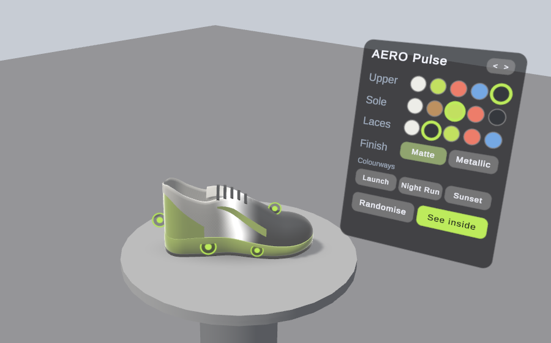
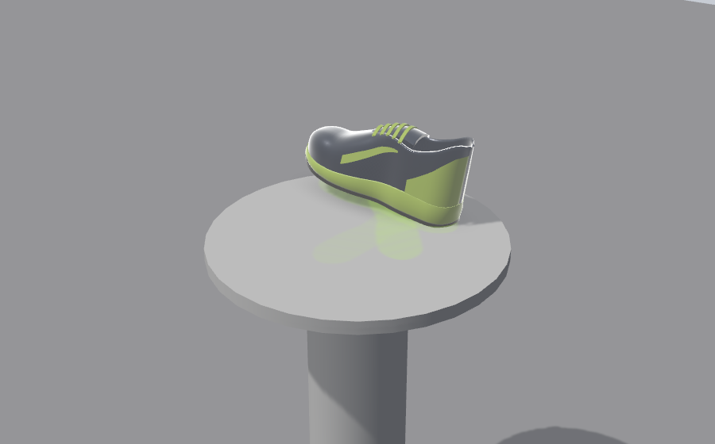

# How it plays

What the user sees and does from launch to the end card, and what the app does when something it wants isn't available. Use it to check behaviour on the headset: this page describes what should happen.

The timings and distances quoted are the defaults in `Assets/_Project/Data/ShowroomTuning.asset`. Every one of them can be changed in the inspector without touching code.

The pictures are editor previews. Without a headset a grey studio replaces the user's room and a pedestal replaces their table.

## Finding a surface

The app opens straight into passthrough: the user's room fades in from black over half a second. A small card floats in front of them and says what is happening, starting with "Finding your table". No product is shown until it has somewhere to stand.

The app tries these in order and stops at the first that works:

| Situation | What happens |
|---|---|
| The headset has a scan of the room, and there is a table in it | The product lands on the nearest table whose top is 0.6 to 1.1 m above the floor and no more than 2 m away. On a small table it takes the centre. On a large one it sits 45 cm in front of the user, at least 18 cm from the edge. No input is needed |
| A scanned room, but no usable table | A pedestal appears on the floor about 60 cm in front of the user, inside the room and clear of furniture, with its top at waist height |
| No scanned room, but the headset can see surfaces with its depth sensor | The card asks the user to "Point and pinch". A reticle follows their hand over real surfaces, green where the product can stand and red where the surface is too steep. A pinch, or the trigger on a controller, places it. The card also offers **Scan my room**, which opens the headset's own room scan, and **Place in front**. If the user does neither for 20 seconds the pedestal is used |
| Room access refused, or none of the above is possible | A pedestal about 60 cm in front of the user |

Three things keep the product where it belongs afterwards:

- The spot is pinned with a spatial anchor, so the product stays on the table when the headset recentres or loses tracking for a moment.
- If the user walks more than 2 m away and stays away for a second and a half, the product is placed again from where they now stand. It glides to the new spot rather than jumping.
- **Move**, on the colour panel once the guided part is over, lets the user place it by hand. With a room scan or the depth sensor to aim at, that is point and pinch. With neither, the user touches a real surface and pinches, and the product lands where their fingertip is. That needs no room data at all.

### Room access

Scanning the room, seeing surfaces and hiding the product behind real objects all need one permission, which Meta calls spatial data. On first launch the card explains why ("Allow room access. So the shoe can land on your real table.") and then the system asks.

If the user refuses, the product goes straight to the pedestal in front of them, and **Move** still works by touch. If they grant it later in the system settings, the app notices, loads the room scan and places the product again, on a table if the scan has one.

This is where the build differs from the design document, which asked for "instant placement" when access is refused. On Quest the instant-placement raycast needs the same permission, so it can't be the fallback for a refusal.

## The guided flow

Seven phases follow, in a fixed order. Each one switches one more thing on and shows one hint; nothing is ever taken away. A phase ends when the user has done what it teaches or when its time is up, and doing the next thing early skips ahead. Pressing **See inside** during Inspect, for example, goes straight to the exploded view.

Hints are a prompt of at most four words above the product, and a translucent "ghost" hand that performs the gesture once beside it. Both disappear the moment the user does the thing.

### 1. Hook

About five seconds, with no input needed. A branded box drops onto the surface and bounces, pauses, and pops its lid. The sneaker rises out of it, turns once under a sweep of light, hangs for a beat and settles. The room dims slightly while this plays, so the product is the brightest thing in view, and the music bed comes in underneath.

Touching the box at any point skips to the product. A product with no packaging skips the box and just rises.

### 2. Inspect

Prompt: "Pick it up", with a ghost hand reaching in and lifting.

- One hand picks the sneaker up, moves it and turns it. Two hands resize it, between half and three times its real size.
- Let go and it springs back to its spot, keeping its size. If hand tracking drops while it is held, it waits half a second for the hand to come back before returning.
- Glowing dots appear on its features after four seconds, or as soon as it is first picked up. After the first release the prompt changes once to "Tap the dots". Poking a dot opens a card with a title and one line. The card closes by itself after five seconds, or when another one is opened.

The AERO Pulse has five dots: Cushioned sole, Breathable mesh, Carbon plate, Reflective heel and Grip outsole. The last is under the sole, for users who turn the shoe over.

Inspect ends once the sneaker has been picked up and put down and at least 6 seconds have passed, or after 18 seconds whatever happened.

### 3. Customise

Prompt: "Make it yours", with a ghost hand tapping the panel.

The colour panel fades in beside the product, on the side of the user's dominant hand, turned to face them. It has:

- **Three rows of five swatches**, one row per region. Upper: Cloud, Volt, Coral, Sky, Graphite. Sole: Cloud, Gum, Volt, Coral, Graphite. Laces: Cloud, Graphite, Volt, Coral, Sky.
- **Finish**: Matte or Metallic, for the upper.
- **Colourways**, the brand's presets: Launch (the starting look), Night Run and Sunset.
- **Randomise**, which changes every region.
- **See inside**, which opens the exploded view.
- **< >**, which moves the panel to the other side for left-handers. The choice is remembered between sessions.

A change doesn't snap. The new colour travels across the sneaker from toe to heel in 0.4 seconds, behind a bright, slightly ragged edge.

Customise ends after two changes and at least 6 seconds, or after 20 seconds.

### 4. Explode

Prompt: "Pull it apart", with two ghost hands, and the **See inside** button pulses.

- **The gesture:** two hands on the sneaker, then 25 cm further apart. Before this phase, two hands only resize it, so the gesture can't fire by accident while the user is still inspecting.
- **The button:** See inside. It becomes **Put together** while the product is apart.
- If the user has tried neither after 15 seconds, the app opens the view for them, so nobody leaves without seeing inside.

The parts move apart over 0.8 seconds. Their names fade in beside them, on the side away from the colour panel, each joined by a hairline to a dot on its own part. The hotspot dots rest while the product is apart.

Each part can be lifted out with one hand and springs back to its place. Holding two parts and bringing them 15 cm closer puts the product back together, as does the button.

The view stays open for 8 seconds, or 4 if the app opened it, and waits while the user is holding something. Then the flow moves on. It also moves on if the user closes the view themselves.

The AERO Pulse comes apart into eight parts: rubber outsole, foam midsole, carbon plate, cushioned insole, knit upper, heel counter, padded tongue and flat laces.

### 5. Reveal

The brand moment, about six seconds. The product goes back together, the panel and the dots step aside, and the sneaker walks a small loop on its own, eight steps, leaving glowing footprints that fade behind it. The loop is sized to the room the surface has, so it never steps off a small table. Picking the sneaker up ends the walk.

### 6. End card

The end card appears on the opposite side from the colour panel, with the product's name and tagline, the colourway the user made (a preset's name, or "Custom") with a chip for each colour, the price, and three buttons:

- **Buy now.** With no store address on the product, which is how the portfolio build is set up, it shows a mock confirmation: "Added to your bag". With one, it opens that page in the headset's browser.
- **Share.** A mock: it shows "Link copied" and records the press. Nothing is copied.
- **Play again.** Back to the hook on the same spot, with the colours, size and assembly reset.

The colour panel and the dots come back, and the card keeps up with any further colour changes. It steps aside while the product is apart, because the labels use its side.

### 7. Free exploration

After ten seconds on the end card, or as soon as the user picks the product up, the guided part is over. The prompt says "Explore freely" and the colour panel gains two buttons: **Move**, to place the product somewhere else, and **Real size**, to undo any resizing. Everything else stays as it is, end card included.

## Hands and controllers

The app is built for bare hands, and switches to controllers by itself when they are picked up. Prompts follow: "Point and pinch" becomes "Point and pull trigger".

| | Hands | Controllers |
|---|---|---|
| Pick up the product or a part | Pinch or palm grab | Grip |
| Resize | Grab with both hands and move them apart or together | The same, with both grips |
| Press a button or a dot | Poke it, or point at it and pinch | Point and pull the trigger |
| Place the product | Point and pinch, or touch a surface and pinch | Point, or touch, and pull the trigger |

Feedback comes through sound with hands, and through sound and short vibrations with controllers. The product also glows softly at its edges while a hand is close enough to grab it, and buttons rise towards a finger that hovers over them.

There is no locomotion. The user stays where they are, and the product comes to them.

## Sound

Effects play from where the thing happened: the box, the sneaker, the panel. The music bed is quiet, isn't positioned in the room, and plays only under the hook and the end card, so the rest of the experience is left to the room's own sound.

## Pausing

Everything freezes, timers and sound included, when the headset is taken off, when the Meta menu is opened, or when the system pauses the app. It resumes only once all of those have cleared.

## What gets recorded

Each run writes one small file on the headset with how long each phase lasted, which colours were chosen, how the exploded view was opened and which buttons were pressed on the end card. Nothing leaves the device. [Architecture](Architecture.md#analytics) lists the fields.
