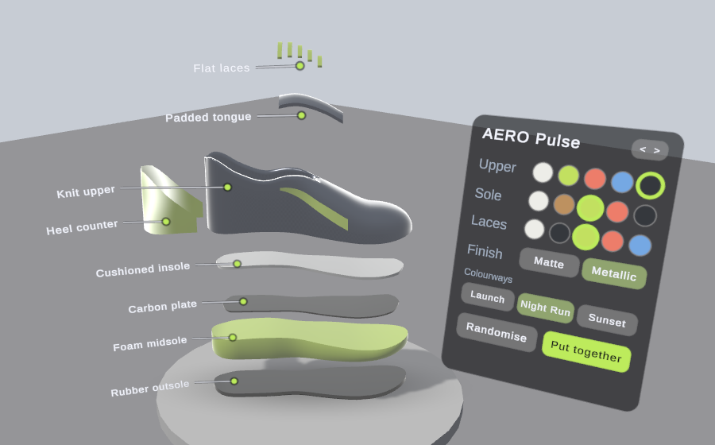
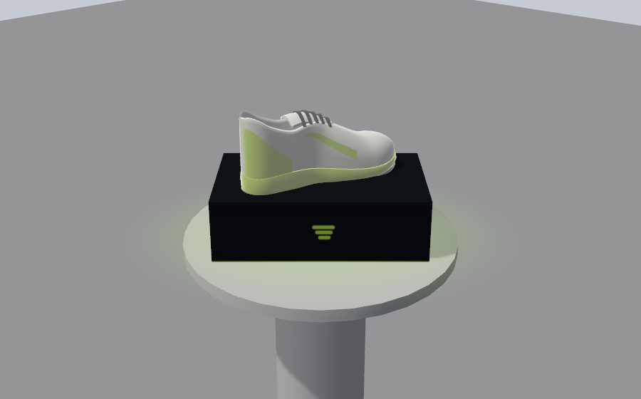
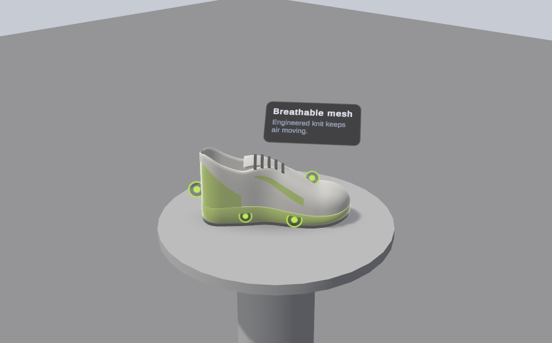
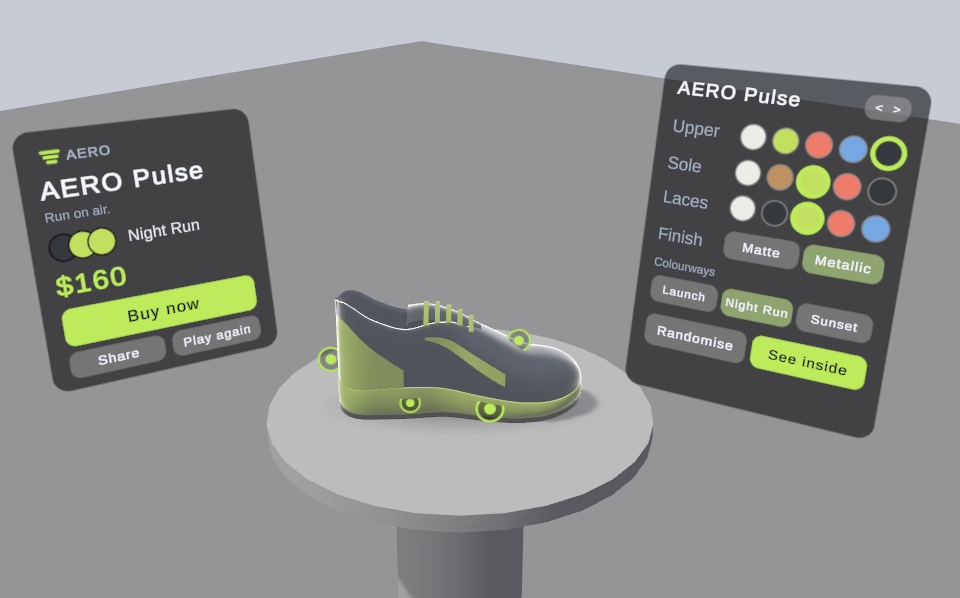

# MR Product Showroom

A mixed reality product showroom for **Meta Quest 3 and 3S**. A sneaker, the fictional **AERO Pulse**, lands on your real table. You pick it up, recolour it, pull it apart to see what it is made of, and finish on a card with a call to action. The whole thing takes about a minute.



*Editor preview. On the headset you see your own room through passthrough, and the product stands on your own table.*

It is a portfolio piece shaped like a playable ad: your product, on your customer's table, in 90 seconds. The sneaker is only the example. The model, colours, feature callouts, exploded view, price and packaging all come from data, so the same app can present a different product.

## Download

**[Download the APK (v0.1.0, 83 MB)](https://github.com/Alihamxamalik/XR-Product-ShowRoom/raw/main/MR-Product-Showroom-v0.1.0.apk)**

This repository holds the app and its description. The source code is not published.

## What you do in it

| Phase | What you do | What the app does |
|---|---|---|
| Find a surface | Nothing, in a room the headset has scanned | Picks the nearest table within reach and pins the product to it |
| Hook | Watch, or touch the box to skip | A branded box drops and bounces, the lid pops off, and the sneaker rises, spins once and settles |
| Inspect | Pick the sneaker up, turn it, resize it with two hands, poke the glowing dots | Springs it back to its spot when you let go. Each dot opens a short card about a feature |
| Customise | Tap swatches on the panel beside it | Sweeps the new colour across the sneaker from toe to heel |
| Explode | Pull it apart with two hands, or press **See inside** | Floats the eight parts apart with a label on each. Any part can be lifted out and springs back |
| Reveal | Watch | The sneaker walks a small loop on the table, leaving glowing footprints that fade |
| End card | Press **Buy now**, **Share** or **Play again** | Shows the name, the colourway you made and the price |
| Free exploration | Anything | Leaves everything switched on, and adds **Move** and **Real size** |

Each phase switches one more thing on and shows one short hint, with a translucent "ghost" hand that performs the gesture once. A phase ends when you have done what it teaches or when its time is up, so nobody gets stuck.

## Features

### It uses your real room

- The app opens straight into passthrough and looks for a table in the headset's room scan. The product lands on the nearest one, with no input needed.
- If there is no usable table, it falls back in steps: you point and pinch at a real surface, or a pedestal appears in front of you.
- The spot is pinned with a spatial anchor, so the product stays put when the headset recentres.
- **Move** lets you place it somewhere else by hand at any time after the guided part.

### Pick it up and look closely

| | |
|---|---|
|  |  |

- One hand picks the sneaker up, moves it and turns it. Two hands resize it, from half to three times its real size.
- Five glowing dots mark its features: cushioned sole, breathable mesh, carbon plate, reflective heel and grip outsole. Poking one opens a short card.

### Make it yours


- Three regions (upper, sole and laces) with five colours each.
- Two finishes for the upper: matte and metallic.
- Three preset colourways (Launch, Night Run and Sunset) and a **Randomise** button.
- The panel sits on the side of your dominant hand and can be swapped to the other side.

### See what it is made of

Pull the sneaker apart with two hands and it separates into eight labelled parts: rubber outsole, foam midsole, carbon plate, cushioned insole, knit upper, heel counter, padded tongue and flat laces. Each part can be lifted out on its own. Push two parts together, or press **Put together**, to reassemble it.

### The finish

| | |
|---|---|
|  |  |

The sneaker walks a loop on your table, then an end card shows the product's name, the colourway you built and the price, with **Buy now**, **Share** and **Play again**. In this build **Buy now** and **Share** are mock-ups: they show a confirmation and do nothing else.

## Controls

The app is built for bare hands and switches to controllers by itself when you pick them up.

| | Hands | Controllers |
|---|---|---|
| Pick up the product or a part | Pinch or palm grab | Grip |
| Resize | Grab with both hands and move them apart or together | The same, with both grips |
| Press a button or a dot | Poke it, or point at it and pinch | Point and pull the trigger |
| Place the product | Point and pinch, or touch a surface and pinch | Point, or touch, and pull the trigger |

There is no locomotion. You stay where you are, and the product comes to you.

## Requirements

- A Meta Quest 3 or Quest 3S.
- Developer mode switched on, because the app is installed from a file and not from the Meta store.
- A room the headset has scanned, with a table in it, gives the best result. The app still works without one.

## Installing

1. Switch on developer mode for your headset in the Meta Horizon phone app.
2. Download the APK from the link above.
3. Connect the headset to a computer with a USB cable and allow the connection inside the headset.
4. Install the file with one of these:
   - **Meta Quest Developer Hub** or **SideQuest**: drag the APK onto the app's window.
   - **adb**, from a terminal:
     ```sh
     adb install -r MR-Product-Showroom-v0.1.0.apk
     ```
5. In the headset, open the app library, choose **Unknown sources** and start **MR Product Showroom**.

On first launch the app asks for room access, which Meta calls spatial data. It uses this to find your table and to hide the product behind real objects. If you refuse, the product appears on a pedestal in front of you instead.

## Privacy

Each run writes one small file on the headset with how long each phase lasted, which colours were chosen and which buttons were pressed. Nothing leaves the device.

## About this build

- Version 0.1.0, package id `com.alihamza.mrshowroom`, built for ARM64 with Vulkan.
- Signed with a debug key, which is normal for a file installed by hand and is not suitable for a store release.
- AERO Pulse is not a real brand. The sneaker, the logo, the box and every sound are stand-ins generated in code.
- Built with Unity 6, the Meta XR SDK (Core, Interaction and MR Utility Kit) and OpenXR.

SHA-256 of the APK: `dd30a750b65cb8afcd520cfb13b434c7fb97f60e5ac09e668e8dddaa13960e39`

## Licence

Copyright © 2026 Ali Hamza. All rights reserved. You may download and run the app for evaluation. The source code is not available.
